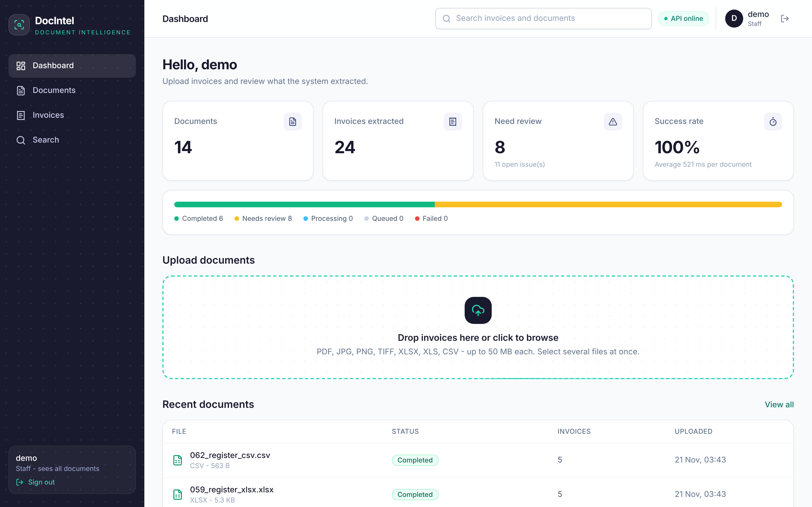
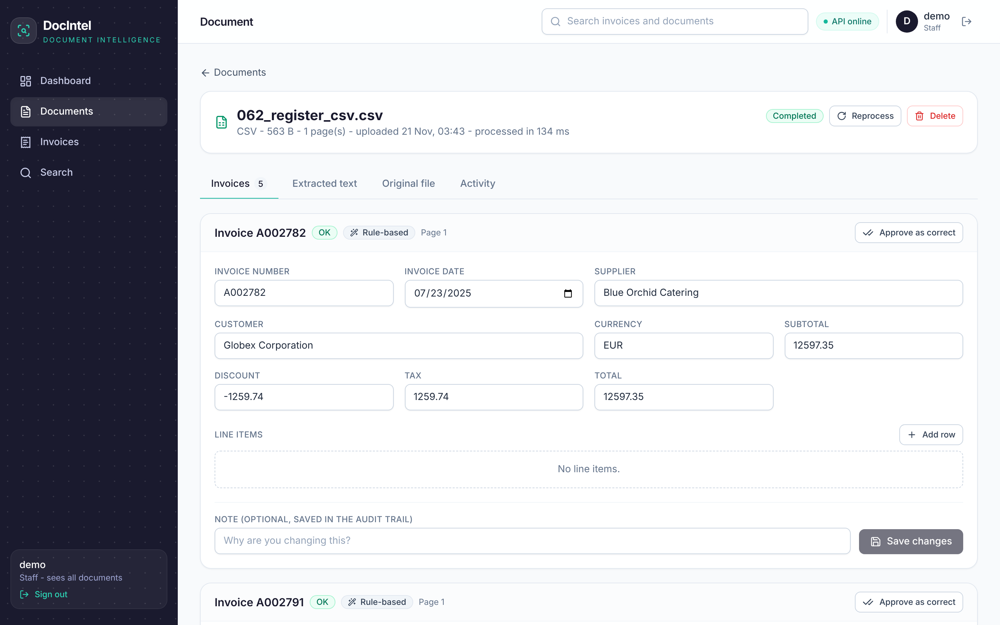
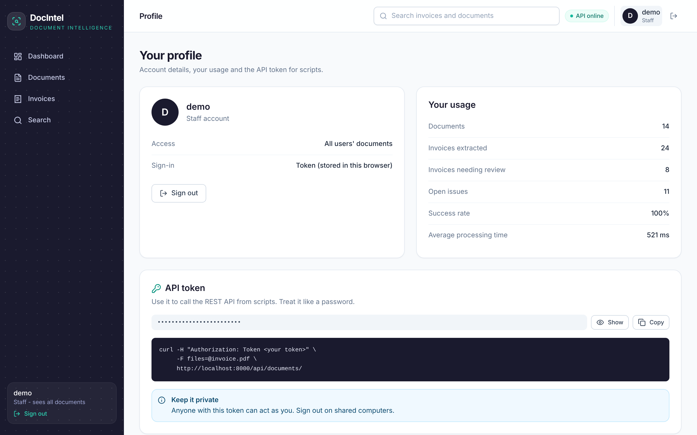

# DocIntel

> From raw invoices to verified, searchable data.

An AI-powered document intelligence system. It reads PDF, JPG/PNG/TIFF, XLSX/XLS and CSV files (including
scanned documents and PDFs of about 1000 pages) with OCR, extracts invoice fields with an LLM **without inventing
values**, validates the numbers, cross-verifies PDF-vs-PDF and PDF-vs-Excel, and makes everything searchable
(keyword, semantic and hybrid) through a REST API and a web app.



| Review an invoice | Search | Profile and API token |
|---|---|---|
|  |  |  |


**Walkthrough video:** _add link here_

## How it works


Upload -> background job (Celery) -> read the file (PDF text, OCR only where needed, spreadsheet rows) ->
split into invoices -> LLM extraction (rule-based fallback) -> grounding check (values must appear in the
document) -> validation -> cross-verification -> search index. Details: [docs/ARCHITECTURE.md](docs/ARCHITECTURE.md).

## Assignment requirements and where they are

| Requirement | Where |
|---|---|
| PDF, JPG, PNG, TIFF, XLSX, XLS, CSV input | [docs/PROCESSING.md](docs/PROCESSING.md) |
| OCR for scans; 1000-page PDFs | RapidOCR, page-by-page streaming; measured in the [rule-based evaluation report](docs/EVALUATION_REPORT_rule_based.md) (section 6, 1000 pages in 12 s) |
| LLM extraction without invented values | [docs/EXTRACTION.md](docs/EXTRACTION.md), [docs/AI_PROMPTS.md](docs/AI_PROMPTS.md) (prompt + grounding check) |
| Validation (missing fields, totals, duplicates) | [docs/EXTRACTION.md](docs/EXTRACTION.md) |
| PDF-PDF and PDF-Excel cross-verification | [docs/EXTRACTION.md](docs/EXTRACTION.md), cross-check panel in the web app |
| REST API with background jobs | [docs/API.md](docs/API.md) |
| Database with keyword and semantic search | [docs/DATABASE_SCHEMA.md](docs/DATABASE_SCHEMA.md), [docs/SEARCH.md](docs/SEARCH.md) |
| React frontend | [docs/FRONTEND.md](docs/FRONTEND.md) |
| Automated tests and results | [docs/TESTING.md](docs/TESTING.md); 239 backend + 39 frontend tests, 90% backend coverage; CI in `.github/workflows/ci.yml` |
| Evaluation report with measured metrics | [docs/EVALUATION_REPORT.md](docs/EVALUATION_REPORT.md) |
| Architecture diagram and schema | [docs/ARCHITECTURE.md](docs/ARCHITECTURE.md), [docs/DATABASE_SCHEMA.md](docs/DATABASE_SCHEMA.md) |
| AI prompts and AI-assisted development disclosure | [docs/AI_PROMPTS.md](docs/AI_PROMPTS.md) |

## Measured results (synthetic benchmark)

Produced by `python manage.py run_evaluation` on 67 files / 116 invoices with exact ground truth (digital and scanned PDFs, photos,
TIFF, XLSX/XLS/CSV; some invoices carry a discount line). This run used the **LLM extractor** (Groq, `openai/gpt-oss-120b`) and the
real embedding model (`BAAI/bge-small-en-v1.5`). The same benchmark with the rule-based fallback is in
[docs/EVALUATION_REPORT_rule_based.md](docs/EVALUATION_REPORT_rule_based.md) (precision 99.7%, recall 97.4%).

| Measure | Result |
|---|---|
| Field extraction (precision / recall / F1) | 99.3% / 98.2% / 98.7% |
| Invented values | 0.71% of returned values (7 wrong, mostly OCR misreads such as `SI/1422` read as `Sl/1422`; 0 where the document has no value) |
| Invoices found | 116 of 116, no extra invoices |
| Digital PDF and Excel/CSV registers | 100% of invoices fully correct |
| Scans / photos (recall) | 89% / 82%, limited by OCR quality |
| Injected problems detected | 17 of 17 (missing field, total mismatch, duplicate file, duplicate invoice, cross-check) |
| Alarms on files with no injected problem | 1 of 54 (a line-item mismatch) |
| PDF-vs-PDF / PDF-vs-Excel verdicts | 12 of 12 correct |
| Search, hybrid mode (Hit@1 / Hit@5 / MRR) | 94.4% / 100% / 0.972 (keyword alone: 55.6% / 55.6% / 0.556) |
| Speed | LLM mode took a median of about 9 s per file on the free Groq tier; the rule-based path takes about 25 ms per digital PDF |
| 1000-page PDF (200 invoices), rule-based | 12.0 s, 190 MB peak memory |

Limits: the data is synthetic, so real-world accuracy can be lower; scans and photos are simulated; the run is one
machine and one seed. Full tables: [docs/EVALUATION_REPORT.md](docs/EVALUATION_REPORT.md).

## Known limitations

- Vectors are compared with NumPy in the application, not in a vector database (fine for tens of thousands of chunks; pgvector is the documented scale-up path).
- LLM mode makes one API call per invoice, so very large files are limited by the free-tier rate limit.
- OCR runs on CPU, so scans are slower than digital PDFs.
- The auth token is kept in `localStorage` (simple, but exposed to XSS); a production deployment would use HttpOnly cookies.
- Only English and Latin-script documents were evaluated.

## AI-assisted development

AI tools were used to help write this project. The honest description, the prompts used by the product, and how
the output was checked are in [docs/AI_PROMPTS.md](docs/AI_PROMPTS.md).

## Tech stack

- **Backend:** Python, Django, Django REST Framework
- **Background jobs:** Celery + Redis
- **Database:** PostgreSQL (SQLite for no-Docker local mode)
- **Document processing:** PyMuPDF (PDF), RapidOCR (OCR, runs locally on CPU), openpyxl / xlrd / csv (spreadsheets)
- **Search:** keyword + semantic (local `fastembed` embeddings, no API key) + hybrid ranking
- **LLM:** Groq API (OpenAI-compatible, JSON mode); rule-based fallback when unavailable
- **Frontend:** React 18, Vite, TypeScript, Tailwind CSS, TanStack Query, Vitest

## Setup

### Option A: Docker (recommended)

Requires Docker Desktop.

```bash
cp .env.example .env        # Windows PowerShell: copy .env.example .env
docker compose up --build
```

Then open the web app at http://localhost:3000 (API health: http://localhost:8000/api/health/ - expected):

```json
{"status": "ok", "service": "docintel-api", "database": "ok", "debug": true}
```

Create an admin user to browse the database at http://localhost:8000/admin/ :

```bash
docker compose exec api python manage.py createsuperuser
```

### Option B: Local mode (no Docker)

Requires Python 3.11+.

```bash
cd backend
python -m venv .venv
.venv\Scripts\activate                 # macOS/Linux: source .venv/bin/activate
pip install -r requirements.txt
copy ..\.env.example ..\.env           # macOS/Linux: cp ../.env.example ../.env
python manage.py migrate
python manage.py runserver
```

### Web app (frontend)

Docker mode already serves it at http://localhost:3000. For local development (needs Node 20+):

```bash
cd frontend
npm install
npm run dev            # http://localhost:5173 - forwards /api to http://localhost:8000
```

Create a login first: `python manage.py create_api_user alice` (run inside `backend/`, or via
`docker compose exec api python manage.py create_api_user alice`). Without Redis, set
`CELERY_TASK_ALWAYS_EAGER=true` in `.env` so uploads are processed immediately.

Features: sign in, multi-file drag-and-drop upload with per-file progress, live processing status,
a header with quick search and an API status indicator, a profile page (usage and API token), a footer, invoice review with validation issues (including discount), inline correction (audit trail), manual invoice entry,
PDF-vs-PDF / PDF-vs-Excel cross-check view, original file preview, extracted text per page,
invoice list with filters, and keyword / semantic / hybrid search.

### Run the tests

```bash
cd backend
pip install -r requirements-dev.txt     # adds xlwt, used to build .xls test files
python manage.py test
```

Frontend tests and production build: `cd frontend && npm test && npm run build`.

Inside Docker: `docker compose exec api python manage.py test` (the XLS test is skipped there
because test-only packages are not installed in the image).

## Use the REST API

Full reference: [docs/API.md](docs/API.md).

```bash
# Docker: the worker container runs background jobs automatically
docker compose exec api python manage.py create_api_user alice      # prints a token

# Local mode without Redis: run jobs inline (set in .env) ...
#   CELERY_TASK_ALWAYS_EAGER=true
# ... or with Redis, start a worker in a second terminal:
#   celery -A config worker -l info          (Windows: add --pool=solo)

TOKEN=<paste token>
curl -H "Authorization: Token $TOKEN" -F files=@invoice.pdf http://localhost:8000/api/documents/
curl -H "Authorization: Token $TOKEN" http://localhost:8000/api/documents/            # list
```

## Search

```bash
curl -H "Authorization: Token $TOKEN" "http://localhost:8000/api/search/?q=acme+invoice&mode=hybrid"
python manage.py reindex_search        # rebuild the index (e.g. after changing the embedding model)
```

The first semantic search/indexing downloads a small embedding model (~130 MB). Without internet access the app
falls back to a built-in embedder automatically. See [docs/SEARCH.md](docs/SEARCH.md).

## Evaluation

Generate a labelled synthetic dataset and measure the real pipeline (accuracy, validation, cross-checks, search, speed):

```bash
cd backend
python manage.py generate_eval_dataset --out eval_data --seed 42
python manage.py run_evaluation --data eval_data --stress-pages 1000 --report ../docs/EVALUATION_REPORT.md
```

Details and the measured results: [docs/TESTING.md](docs/TESTING.md), [docs/EVALUATION_REPORT.md](docs/EVALUATION_REPORT.md).

## Try the pipeline from the command line

Run any PDF, image, Excel or CSV file through the full pipeline (OCR, AI extraction, validation,
cross-verification) and print the extracted invoices and any issues:

```bash
cd backend
python manage.py migrate                                   # first time only (local mode)
python manage.py process_files path/to/invoice.pdf path/to/scan.png
python manage.py process_files path/to/folder --json-out summary.json
python manage.py process_files invoice.pdf --show-text      # also print the raw extracted text
python manage.py process_files invoice.pdf --no-llm         # rule-based extraction only
```

To use the LLM, put `GROQ_API_KEY` and `GROQ_MODEL` in `.env` (see `.env.example`).
Without them the pipeline automatically uses the rule-based extractor.
Process an invoice PDF and an Excel register containing the same invoice to see cross-verification.

- [docs/PROCESSING.md](docs/PROCESSING.md): how each file type is read
- [docs/EXTRACTION.md](docs/EXTRACTION.md): AI extraction, validation and cross-verification

## Documentation

- [Architecture](docs/ARCHITECTURE.md) and [database schema](docs/DATABASE_SCHEMA.md)
- [REST API](docs/API.md) and [search](docs/SEARCH.md)
- [Document processing](docs/PROCESSING.md) and [AI extraction, validation, cross-verification](docs/EXTRACTION.md)
- [Web app](docs/FRONTEND.md)
- [Testing](docs/TESTING.md) and the evaluation reports: [LLM run](docs/EVALUATION_REPORT.md), [rule-based baseline](docs/EVALUATION_REPORT_rule_based.md)
- [AI prompts and disclosure](docs/AI_PROMPTS.md)

## License

MIT
