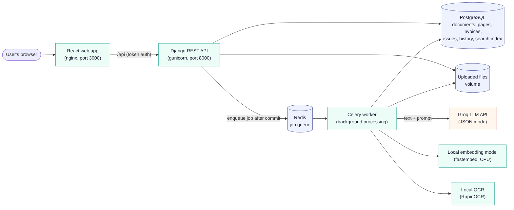
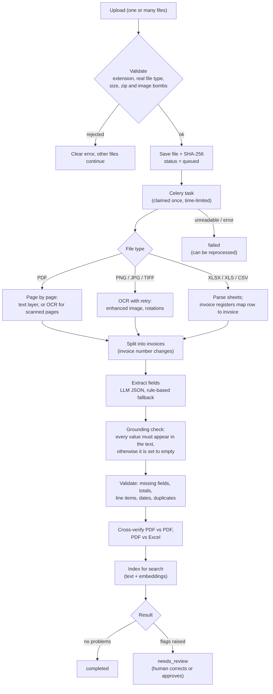

# Architecture

## System overview

| Part | Technology | Role |
|---|---|---|
| Web app | React 18, TypeScript, Vite, Tailwind CSS (served by nginx) | Upload, progress, review, correction, search |
| API | Django 5 + Django REST Framework (gunicorn) | Authentication, upload, status, results, search, corrections, reprocessing |
| Background jobs | Celery + Redis | OCR, AI extraction, validation, indexing, off the request path |
| Database | PostgreSQL (SQLite for the optional no-Docker mode) | Metadata, extracted text, structured results, issues, history, search index |
| OCR | RapidOCR (ONNX, CPU) | Scanned PDF pages and images, no API cost |
| LLM | Groq API, JSON mode | Field extraction; rule-based fallback when unavailable |
| Embeddings | fastembed, `BAAI/bge-small-en-v1.5` (CPU) | Semantic search, no API key |

## Processing pipeline

1. **Upload.** Every file is checked by extension *and* content (magic bytes), size, zip-bomb and image-bomb
   limits. One bad file never blocks the others. The file is stored under a random name with its SHA-256.
2. **Queue.** The job is sent to Celery only after the database transaction commits. If the broker is down the
   document is marked `failed` ("could not be queued") and can be reprocessed.
3. **Read the document.** PDFs are read page by page (only pages without a text layer go to OCR, so a
   1000-page PDF stays fast and light). Images are OCR'd, with a retry using an enhanced image and rotations
   when the first result is weak. Spreadsheets are parsed sheet by sheet; a sheet that looks like an invoice
   register maps each row to one invoice without needing an LLM.
4. **Split.** One file can contain many invoices; pages are grouped by invoice number.
5. **Extract.** The text goes to the LLM with a strict prompt (`docs/AI_PROMPTS.md`). If there is no key, or the
   LLM keeps failing (circuit breaker), the rule-based extractor is used.
6. **Grounding check.** Every extracted value must appear in the source text. A value that does not is dropped to
   empty and flagged, so the system cannot invent numbers.
7. **Validate.** Missing fields (graded error / warning / info), subtotal + discount + tax = total, line items = subtotal,
   negative amounts, odd dates, duplicate files (SHA-256) and duplicate invoices (supplier + number), low OCR confidence.
8. **Cross-verify.** The same invoice found in two documents (PDF-PDF or PDF-Excel) is compared field by field.
9. **Index.** Invoice summaries and page text are stored as search chunks with embeddings.
10. **Result.** `completed`, `needs_review` (a person corrects or approves) or `failed` (can be retried).

A reviewer's correction re-runs validation and the cross-checks, updates the search index and is written to an audit log.

## Data model

See [DATABASE_SCHEMA.md](DATABASE_SCHEMA.md). The essentials: one `Document` has many `ExtractionResult` rows
(invoices); results have line items, validation issues and a correction log; every processing stage is stored as
a `ProcessingEvent`; `SearchChunk` holds searchable text and its embedding.

## Design decisions

| Decision | Why | Trade-off |
|---|---|---|
| Python / Django instead of Node | The OCR, PDF and spreadsheet ecosystem is Python; Django gives auth, ORM, migrations and admin for free | Two languages in the repo (Python backend, TypeScript frontend) |
| Groq (OpenAI-compatible API) | Free tier, fast, JSON mode; swapping provider only means changing the base URL and model | Free-tier rate limits; one API call per invoice |
| LLM output is grounded and rule-checked | The assignment forbids invented values; a model cannot be trusted blindly | A correct value that is formatted unusually can be dropped and flagged for review |
| Rule-based fallback | The system still works with no key or during an outage | Lower accuracy, and it never guesses a supplier from a letterhead |
| Local OCR and local embeddings | No per-page cost, no data leaves the machine except text sent to the LLM | CPU only; slower than a GPU or a paid OCR API |
| Vectors stored as bytes in PostgreSQL, compared with NumPy | Works the same on SQLite and PostgreSQL; fast for tens of thousands of chunks | Not a vector database. For millions of chunks, move to a pgvector column with an HNSW index; the search interface would not change |
| Celery + Redis | Standard, reliable queue; scales by adding workers | Another service to run |
| Token authentication, token kept in `localStorage` | Simple for a single-page app | An XSS bug could read it; production would use short-lived tokens or HttpOnly cookies |

## Scalability

- The API is stateless; run more API containers behind a load balancer.
- Processing scales by adding Celery workers (`--concurrency` and more containers). Jobs are idempotent and time-limited.
- PDFs are streamed page by page; spreadsheets are read in read-only mode with a row limit; OCR works on one page at a time.
- Lists are paginated; important columns are indexed; search is capped (`SEMANTIC_MAX_CANDIDATES`).
- Uploaded files live on a volume; for several machines they would move to object storage (S3-compatible).
- The LLM is the main throughput limit (one call per invoice). The 1000-page run (12 s, 190 MB) in the rule-based evaluation report used the rule-based path.

## Reliability

- Jobs are acknowledged after they finish (`acks_late`) and claimed atomically, so duplicates do not process twice and a crashed worker's job is resumed.
- Soft and hard time limits turn runaway jobs into `failed` documents with a clear message.
- `manage.py recover_stuck_documents` fails stuck jobs and re-queues stale ones.
- Per-page OCR errors are recorded without failing the whole document; corrupted files fail cleanly with a safe message.
- LLM calls retry with backoff (honouring `Retry-After`), never retry on authentication errors, and a circuit breaker switches to the fallback.

## Security

- Token authentication; every query is filtered by owner (users cannot see each other's documents; staff can).
- Rate limits on login, upload, reprocess, polling and search.
- Content-based upload validation, size and file-count limits, zip-bomb and image-bomb guards, random on-disk names, sanitised display names.
- Original files are served with `nosniff` and a sandboxing Content-Security-Policy; types that browsers could execute are forced to download.
- Error messages never include paths or stack traces (details go to server logs).
- The LLM receives document text only inside `<document>` tags with instructions to treat it as data, and its output is strictly parsed, which limits prompt injection.
- The API key is read from the environment, never logged or returned; `.env` is git-ignored; the container runs as a non-root user.
