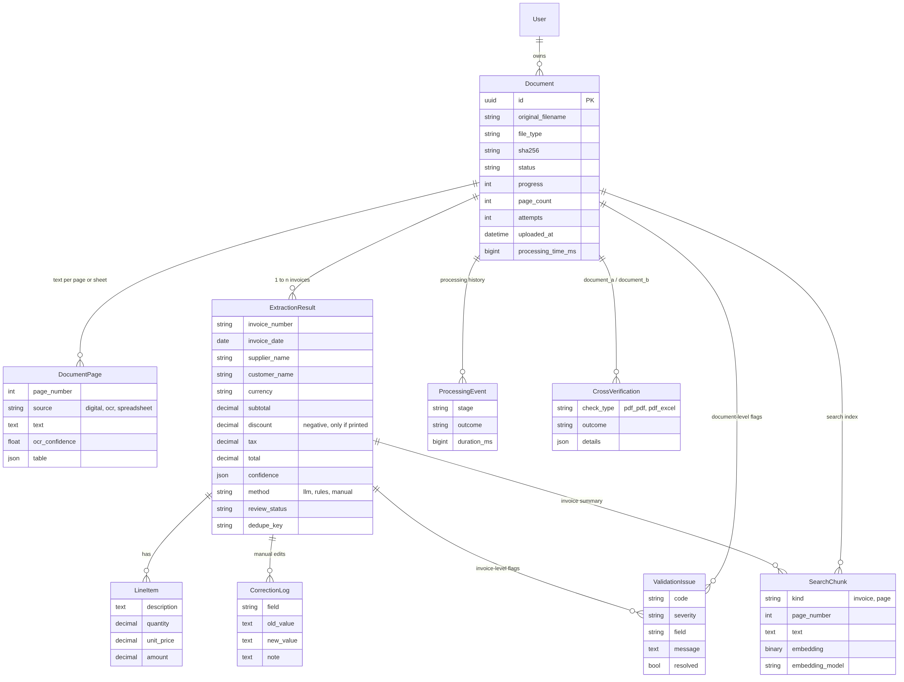
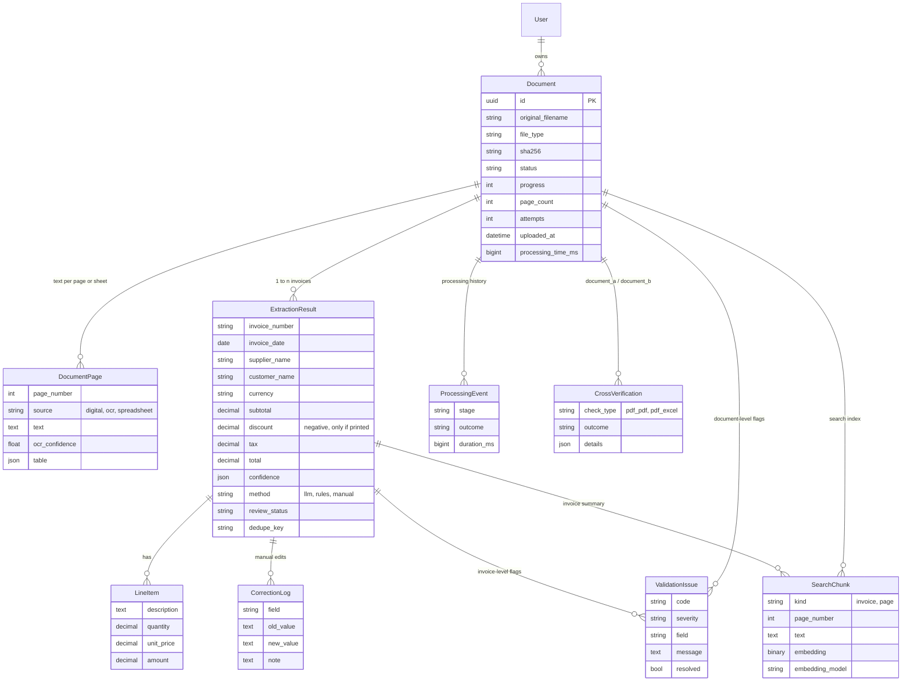

# Database schema

PostgreSQL. SQLite is used only for the optional no-Docker local mode.

Mermaid source (renders on GitHub):

## Design decisions

- **One document, many invoices.** A ~1000-page PDF can hold many invoices, so
  `ExtractionResult` is a child of `Document` (with `page_start` / `page_end`).
- **Missing values are NULL.** Extracted fields are nullable; the system never
  stores a guessed value or a default `0`.
- **Duplicate detection.** `Document.sha256` catches identical re-uploads;
  `ExtractionResult.dedupe_key` (normalised supplier + invoice number) catches the
  same invoice arriving as a different file.
- **Audit trail.** `ProcessingEvent` records every stage with duration and outcome;
  `CorrectionLog` records every manual change (old value -> new value).
- **Cross-verification** (pdf-pdf, pdf-excel) is stored in `CrossVerification` with
  per-field differences in `details`.
- **Indexes** on status, supplier, invoice number/date and dedupe key keep filtering
  fast as volume grows.
- **Search index.** `SearchChunk` stores searchable text (an invoice summary or a slice of a page) and its
  embedding as raw float32 bytes plus the name of the model that produced it, so keyword and semantic search work
  on SQLite and PostgreSQL alike and vectors from different models are never compared. For a very large
  collection a pgvector column with an HNSW index is the next step.
- **Ownership.** `Document.owner` links each document to a user; every API query is filtered by it.
