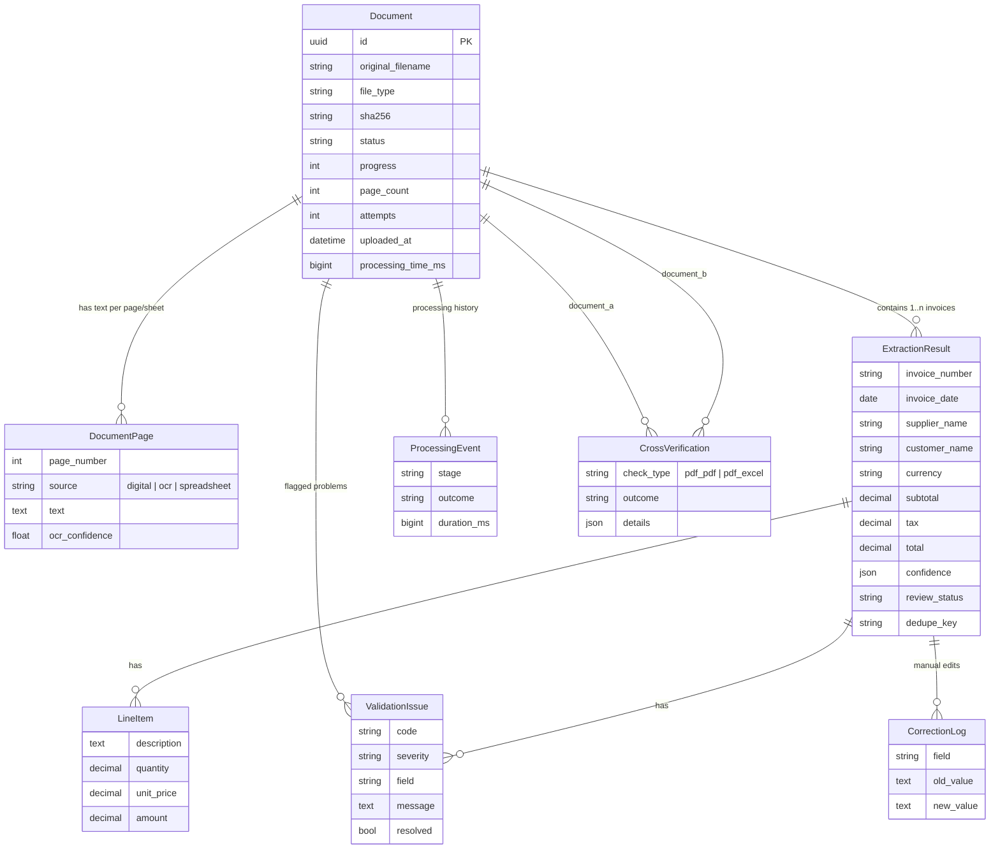

# Database schema

PostgreSQL (with the pgvector extension, used for semantic search from Phase 5).
SQLite is used only for the optional no-Docker local mode.

## Design decisions

- **One document, many invoices.** A ~1000-page PDF can hold many invoices, so
  `ExtractionResult` is a child of `Document` (with `page_start` / `page_end`).
- **Missing values are NULL.** Extracted fields are nullable; the system never
  stores a guessed value or a default `0`.
- **Duplicate detection.** `Document.sha256` catches identical re-uploads;
  `ExtractionResult.dedupe_key` (normalised supplier + invoice number) catches the
  same invoice arriving as a different file.
- **Audit trail.** `ProcessingEvent` records every stage with duration and outcome;
  `CorrectionLog` records every manual change (old value -> new value).
- **Cross-verification** (pdf-pdf, pdf-excel) is stored in `CrossVerification` with
  per-field differences in `details`.
- **Indexes** on status, supplier, invoice number/date and dedupe key keep filtering
  fast as volume grows.
- A vector-embedding table for semantic search is added in Phase 5.
